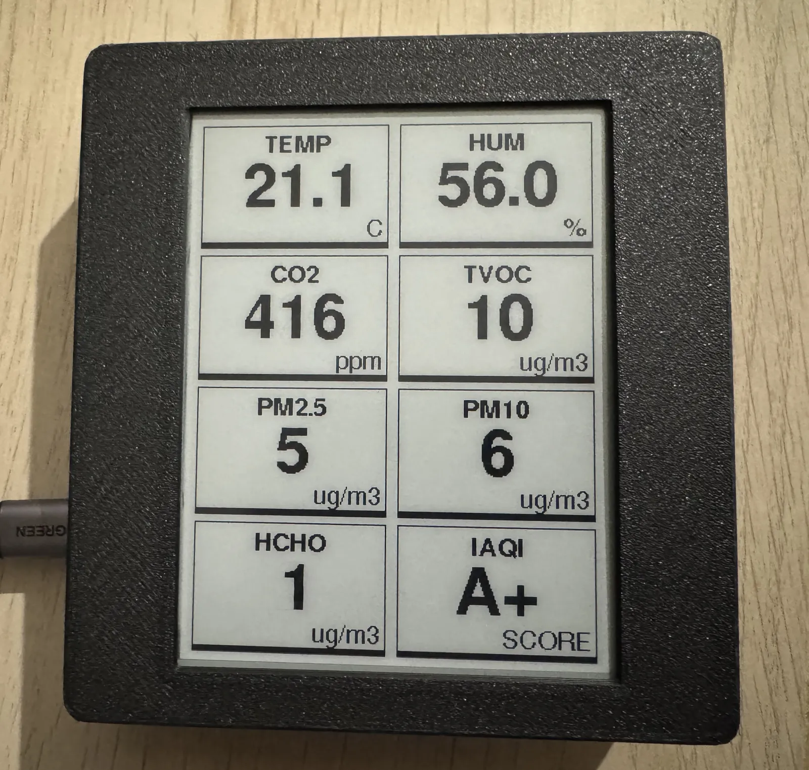

# Matter Air Quality Sensor

An indoor air quality monitor built on an ESP32-C6. It shows its readings on an e-ink screen and exposes them over Matter, so the same device works with HomeKit and Home Assistant at the same time.

  

The story of how it was built, and everything that went wrong along the way, is in the [blog post](https://www.icarrea.dev/posts/matterairmonitor).

## Features

- Measures CO2, TVOC, formaldehyde (HCHO), PM2.5, PM10, temperature and humidity with a single M702 sensor.
- Calculates an overall air quality grade (A+ to F) from the worst individual reading.
- Shows everything on a 4.2" e-ink screen that only redraws when a value changes noticeably.
- Exposes the readings and the grade over Matter (Wi-Fi). Tested with HomeKit and Home Assistant.

## Parts

- [Waveshare ESP32-C6-Zero](https://docs.waveshare.com/ESP32-C6-Zero?variant=ESP32-C6-Zero). Any ESP32-C6 or other Matter-capable ESP32 should work with small pin changes.
- [WeAct 4.2"](https://github.com/WeActStudio/WeActStudio.EpaperModule) black and white e-paper module. Other GxEPD2-supported screens work if you change the driver.
- M702 UART air quality sensor.
- The 3D-printed case (`airquality_v5.3mf`), plus M2 and M3 brass heat-set inserts and screws.

## Wiring

### E-ink screen (WeAct 4.2")

| Screen pin       | ESP32-C6-Zero |
| ---------------- | ------------- |
| VCC              | 3V3           |
| GND              | GND           |
| SDA (DIN / MOSI) | GP21          |
| SCL (CLK / SCK)  | GP22          |
| CS               | GP20          |
| D/C              | GP19          |
| RES              | GP18          |
| BUSY             | GP14          |

### M702 sensor

| Sensor pin | ESP32-C6-Zero |
| ---------- | ------------- |
| VCC        | 5V            |
| GND        | GND           |
| TX         | GP0           |
| NC         | —             |

> [!WARNING]
> The sensor needs **5V** and the screen **3.3V**. Don't mix them up.

The pins avoid the ESP32-C6 strapping pins (4, 5, 8, 9, 15), native USB (12, 13) and UART0 (16, 17), so the board boots and flashes normally with everything connected.

## Build and flash

This uses the Arduino IDE (or `arduino-cli`) instead of ESP-IDF. Some Matter clusters have no Arduino wrapper yet, so the sketch creates them directly with the `esp_matter` API that ships with the ESP32 Arduino core.

1. Install the **esp32** board package by Espressif. It was built with version **3.3.11**. The Matter API changes between releases, so other versions may need small fixes.
2. Install these libraries from the Library Manager:
   - **GxEPD2** (built with 1.6.9)
   - **Adafruit GFX Library** (built with 1.12.6)
3. Open `sensorMonitor_v1.ino` and select these board settings:

   | Setting          | Value                            |
   | ---------------- | -------------------------------- |
   | Board            | ESP32C6 Dev Module               |
   | USB CDC On Boot  | Enabled                          |
   | Partition Scheme | Huge APP (3MB No OTA/1MB SPIFFS) |
   | Flash Size       | 4MB                              |

   **Huge APP** is required: the Matter stack doesn't fit in the default partition.

4. Upload.

## Pairing

1. Open the serial monitor at **115200** baud and reset the board.
2. The first time, it prints a **manual pairing code** and a **QR code URL**. Open the URL to get a QR code you can scan.
3. Add it from your Home app (HomeKit, Home Assistant, Google Home…). The phone sends the Wi-Fi credentials over Bluetooth during pairing.
4. HomeKit will warn that the accessory is not certified. Accept it to continue.

Once paired, it reconnects to the stored network on every boot.

To reset it, **hold the BOOT button for 5 seconds**. It decommissions itself and can be paired again.

> [!NOTE]
> CO2, TVOC and HCHO need about 5 minutes to warm up. Until then the screen shows `--` and those values are not sent over Matter.

## What each app shows

| Reading      | Screen | HomeKit |          Home Assistant          |
| ------------ | :----: | :-----: | :------------------------------: |
| Air quality  |   ✅   |   ✅    |                ✅                |
| CO2          |   ✅   |   ✅    |                ✅                |
| PM2.5 / PM10 |   ✅   |   ✅    |                ✅                |
| TVOC         |   ✅   |   ✅    | ⚠️ shown as ppm instead of µg/m³ |
| HCHO         |   ✅   |   ❌    |                ❌                |
| Temperature  |   ✅   |   ✅    |                ✅                |
| Humidity     |   ✅   |   ✅    |                ✅                |

## Air quality grade

The grade is the worst grade among all the readings. PM bands follow the European Air Quality Index; the rest are based on common indoor guidelines.

| Grade | CO2 (ppm) | PM2.5 (µg/m³) | PM10 (µg/m³) | TVOC (µg/m³) | HCHO (µg/m³) |
| ----- | --------- | ------------- | ------------ | ------------ | ------------ |
| A+    | ≤ 600     | ≤ 10          | ≤ 20         | ≤ 300        | ≤ 30         |
| A     | ≤ 800     | ≤ 20          | ≤ 40         | ≤ 500        | ≤ 60         |
| B     | ≤ 1000    | ≤ 25          | ≤ 50         | ≤ 1000       | ≤ 100        |
| C     | ≤ 1500    | ≤ 50          | ≤ 100        | ≤ 3000       | ≤ 200        |
| F     | > 1500    | > 50          | > 100        | > 3000       | > 200        |

Humidity only adds a comfort penalty and never drops the grade below B: under 30% or over 60% gives an A, under 25% or over 70% gives a B.

Over Matter the grade is mapped to the Air Quality cluster: A+ → Good, A → Fair, B → Moderate, C → Poor, F → Very Poor.

## Customising

Everything is in `sensorMonitor_v1.ino`:

| What                         | Where                                                                 |
| ---------------------------- | --------------------------------------------------------------------- |
| Name shown in the Home apps  | `DEVICE_VENDOR_NAME`, `DEVICE_PRODUCT_NAME` (max 32 characters)       |
| Pins                         | `EPD_*_PIN`, `CS_PIN`, `DC_PIN`, `RES_PIN`, `BUSY_PIN`, `M702_RX_PIN` |
| Screen model and rotation    | the `display(...)` declaration and `display.setRotation()`            |
| Update interval              | `INTERVAL` (ms, default 3000)                                         |
| Full redraw against ghosting | `FULL_REFRESH_INTERVAL` (in update cycles, default 1000 ≈ 50 min)     |
| Gas warm-up time             | `GAS_WARMUP_MS` (default 5 minutes)                                   |
| When the screen redraws      | `co2Changed()`, `pmChanged()`, `tempChanged()`…                       |
| Grade thresholds             | `calculateIAQI()`                                                     |

## Case

`airquality_v5.3mf` contains the case, ready to slice. It was printed in matte PLA with the slicer's default settings, nothing special. The parts are held together with M2 and M3 brass heat-set inserts, so you can use normal screws.

## Roadmap

- Port to the ESP-IDF Matter SDK to use Thread instead of Wi-Fi.
