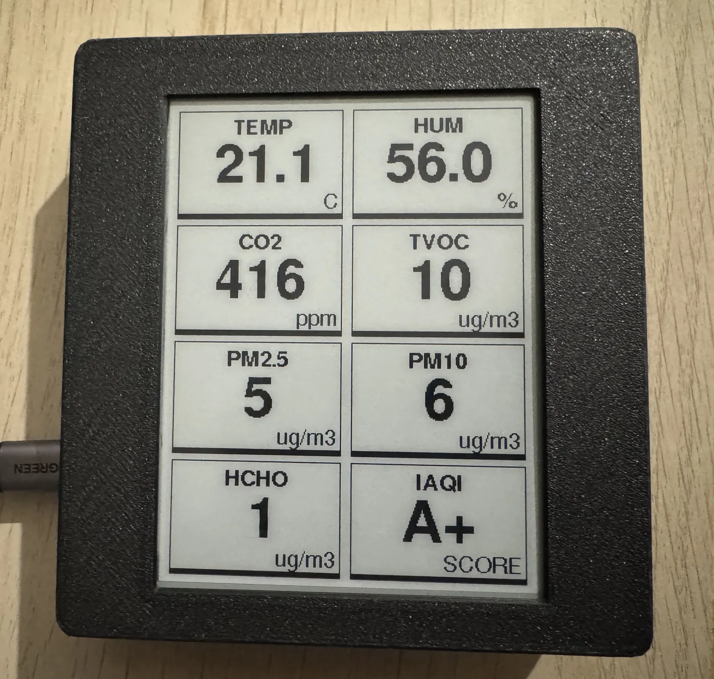

# Matter Air Quality Sensor

An indoor air quality monitor built on an ESP32-C6. It shows its readings on an e-ink screen and exposes them over Matter, so the same device works with HomeKit and Home Assistant at the same time.

<p align="center">
  
</p>

The story of how it was built, and everything that went wrong along the way, is in the [blog post](https://www.icarrea.dev/posts/matterairmonitor).

## Features

- Measures CO2, TVOC, formaldehyde (HCHO), PM2.5, PM10, temperature and humidity with a single M702 sensor.
- Calculates an overall air quality grade (A+ to F) from the worst individual reading.
- Shows everything on a 4.2" e-ink screen that only redraws when a value changes noticeably.
- Each reading with a grade has a small bar of shaded squares under its value: five squares means A+, one square means F.
- Exposes the readings and the grade over Matter. Tested with HomeKit and Home Assistant.
- Two firmware versions for the same hardware:
  - **Arduino** (`sensorMonitor_v1.ino`): Matter over **Wi-Fi**, the easiest to build.
  - **ESP-IDF** (`idf/`): Matter over **Thread**, with its own pairing code per device and the pairing QR code drawn on the e-ink screen.

## Parts

- [Waveshare ESP32-C6-Zero](https://docs.waveshare.com/ESP32-C6-Zero?variant=ESP32-C6-Zero). Any ESP32-C6 or other Matter-capable ESP32 should work with small pin changes.
- [WeAct 4.2"](https://github.com/WeActStudio/WeActStudio.EpaperModule) black and white e-paper module. Other GxEPD2-supported screens work if you change the driver.
- M702 UART air quality sensor.
- The 3D-printed case (`airquality_v5.3mf`), plus M2 and M3 brass heat-set inserts and screws.

## Wiring

### E-ink screen (WeAct 4.2")

| Screen pin       | ESP32-C6-Zero |
| ---------------- | ------------- |
| VCC              | 3V3           |
| GND              | GND           |
| SDA (DIN / MOSI) | GP21          |
| SCL (CLK / SCK)  | GP22          |
| CS               | GP20          |
| D/C              | GP19          |
| RES              | GP18          |
| BUSY             | GP14          |

### M702 sensor

| Sensor pin | ESP32-C6-Zero |
| ---------- | ------------- |
| VCC        | 5V            |
| GND        | GND           |
| TX         | GP0           |
| NC         | —             |

> [!WARNING]
> The sensor needs **5V** and the screen **3.3V**. Don't mix them up.

The pins avoid the ESP32-C6 strapping pins (4, 5, 8, 9, 15), native USB (12, 13) and UART0 (16, 17), so the board boots and flashes normally with everything connected.

## Build and flash

Pick one of the two versions. Both use the same wiring and the same screen layout.

### Arduino version (Wi-Fi)

This uses the Arduino IDE (or `arduino-cli`) instead of ESP-IDF. Some Matter clusters have no Arduino wrapper yet, so the sketch creates them directly with the `esp_matter` API that ships with the ESP32 Arduino core.

1. Install the **esp32** board package by Espressif. It was built with version **3.3.11**. The Matter API changes between releases, so other versions may need small fixes.
2. Install these libraries from the Library Manager:
   - **GxEPD2** (built with 1.6.9)
   - **Adafruit GFX Library** (built with 1.12.6)
3. Open `sensorMonitor_v1.ino` and select these board settings:

   | Setting          | Value                            |
   | ---------------- | -------------------------------- |
   | Board            | ESP32C6 Dev Module               |
   | USB CDC On Boot  | Enabled                          |
   | Partition Scheme | Huge APP (3MB No OTA/1MB SPIFFS) |
   | Flash Size       | 4MB                              |

   **Huge APP** is required: the Matter stack doesn't fit in the default partition.

4. Upload.

### ESP-IDF version (Thread)

This is a native port to ESP-IDF and the esp-matter SDK. It uses the ESP32-C6's 802.15.4 radio to join a Thread network instead of Wi-Fi, so you need a Thread border router (for example an Apple TV 4K, a HomePod mini or a Home Assistant SkyConnect). Bluetooth is only used during pairing.

It was built with **ESP-IDF v5.5.6** and **esp-matter 1.5.x**, which is the same esp-matter version as the Arduino core 3.3.11. esp-matter and the QR code library are downloaded automatically from the ESP component registry (`idf/main/idf_component.yml`), so you only need ESP-IDF installed.

1. Install [ESP-IDF v5.5.x](https://docs.espressif.com/projects/esp-idf/en/v5.5.6/esp32c6/get-started/index.html) and activate its environment. Install `esp-matter-mfg-tool` in the IDF Python environment (`pip install esp-matter-mfg-tool`).
2. Generate the pairing data for your device, once per device:

   ```sh
   cd idf
   ./factory/gen_factory.sh
   ```

   This creates a random passcode and discriminator and a new device certificate (DAC) in `idf/factory/out/fctry.bin`. The certificate is signed by the public Matter test PAI (VID 0xFFF1 / PID 0x8000), so the device is uncertified but pairs normally. The vendor and product names shown in the Home apps are set in this script.

   > [!IMPORTANT]
   > `idf/factory/out/` holds the device's private key and passcode and is git-ignored. Keep a backup. If you lose it, generate new data and pair the device again.

3. Build and flash. `idf.py flash` writes the factory partition too:

   ```sh
   idf.py set-target esp32c6      # first time only
   idf.py build
   idf.py -p /dev/ttyACM0 erase-flash flash monitor
   ```

The partition table (`idf/partitions.csv`) matches the Arduino "Huge APP" layout and adds a `fctry` partition for the pairing data. More details are in [`idf/README.md`](idf/README.md).

## Pairing

**Arduino version**

1. Open the serial monitor at **115200** baud and reset the board.
2. The first time, it prints a **manual pairing code** and a **QR code URL**. Open the URL to get a QR code you can scan.
3. Add it from your Home app (HomeKit, Home Assistant, Google Home…). The phone sends the Wi-Fi credentials over Bluetooth during pairing.

**ESP-IDF version**

1. While it's not paired, the e-ink screen shows the **QR code** and the **manual pairing code**. A printable copy is in `idf/factory/out/qrcode.png`.
2. Scan it from your Home app. The phone gives it the Thread network credentials over Bluetooth.

With either version, HomeKit will warn that the accessory is not certified. Accept it to continue.

Once paired, it reconnects to the stored network on every boot.

To reset it, **hold the BOOT button for 5 seconds**. It decommissions itself and can be paired again. On the ESP-IDF version, removing the device from the last Home app it's paired with also resets it, and the pairing code stays the same after a reset because it lives in its own partition.

> [!NOTE]
> CO2, TVOC and HCHO need about 5 minutes to warm up. Until then the screen shows `--` and those values are not sent over Matter.

## What each app shows

| Reading      | Screen | HomeKit |          Home Assistant          |
| ------------ | :----: | :-----: | :------------------------------: |
| Air quality  |   ✅   |   ✅    |                ✅                |
| CO2          |   ✅   |   ✅    |                ✅                |
| PM2.5 / PM10 |   ✅   |   ✅    |                ✅                |
| TVOC         |   ✅   |   ✅    | ⚠️ shown as ppm instead of µg/m³ |
| HCHO         |   ✅   |   ❌    |                ❌                |
| Temperature  |   ✅   |   ✅    |                ✅                |
| Humidity     |   ✅   |   ✅    |                ✅                |

## Air quality grade

The grade is the worst grade among all the readings. PM bands follow the European Air Quality Index; the rest are based on common indoor guidelines.

| Grade | CO2 (ppm) | PM2.5 (µg/m³) | PM10 (µg/m³) | TVOC (µg/m³) | HCHO (µg/m³) |
| ----- | --------- | ------------- | ------------ | ------------ | ------------ |
| A+    | ≤ 600     | ≤ 10          | ≤ 20         | ≤ 300        | ≤ 30         |
| A     | ≤ 800     | ≤ 20          | ≤ 40         | ≤ 500        | ≤ 60         |
| B     | ≤ 1000    | ≤ 25          | ≤ 50         | ≤ 1000       | ≤ 100        |
| C     | ≤ 1500    | ≤ 50          | ≤ 100        | ≤ 3000       | ≤ 200        |
| F     | > 1500    | > 50          | > 100        | > 3000       | > 200        |

Humidity only adds a comfort penalty and never drops the grade below B: under 30% or over 60% gives an A, under 25% or over 70% gives a B.

Over Matter the grade is mapped to the Air Quality cluster: A+ → Good, A → Fair, B → Moderate, C → Poor, F → Very Poor.

## Customising

In the Arduino version everything is in `sensorMonitor_v1.ino`. In the ESP-IDF version the same settings are in `idf/main/app_main.cpp` (pins, intervals, warm-up) and `idf/main/ui.cpp` (screen layout, redraw rules, grade thresholds), and the names shown in the Home apps are set in `idf/factory/gen_factory.sh`.

| What                         | Where                                                                 |
| ---------------------------- | --------------------------------------------------------------------- |
| Name shown in the Home apps  | `DEVICE_VENDOR_NAME`, `DEVICE_PRODUCT_NAME` (max 32 characters)       |
| Pins                         | `EPD_*_PIN`, `CS_PIN`, `DC_PIN`, `RES_PIN`, `BUSY_PIN`, `M702_RX_PIN` |
| Screen model and rotation    | the `display(...)` declaration and `display.setRotation()`            |
| Update interval              | `INTERVAL` (ms, default 3000)                                         |
| Full redraw against ghosting | `FULL_REFRESH_INTERVAL` (in update cycles, default 1000 ≈ 50 min)     |
| Gas warm-up time             | `GAS_WARMUP_MS` (default 5 minutes)                                   |
| When the screen redraws      | `co2Changed()`, `pmChanged()`, `tempChanged()`…                       |
| Grade thresholds             | `calculateIAQI()`                                                     |

## Case

`airquality_v5.3mf` contains the case, ready to slice. It was printed in matte PLA with the slicer's default settings, nothing special. The parts are held together with M2 and M3 brass heat-set inserts, so you can use normal screws.

## License

Copyright (C) 2026 Ismael Carrea

This project, including the code, the 3D case and the images, is licensed under the [GNU General Public License v3.0](LICENSE). You can use, modify and share it, including commercially, as long as any version you distribute is also released under GPL-3.0 with its source.
